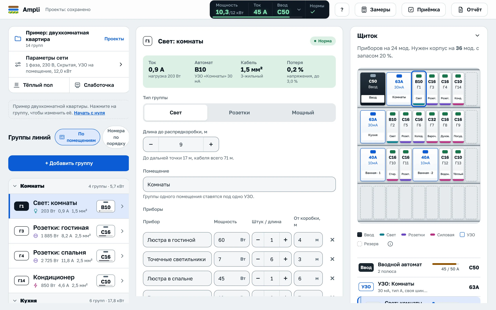
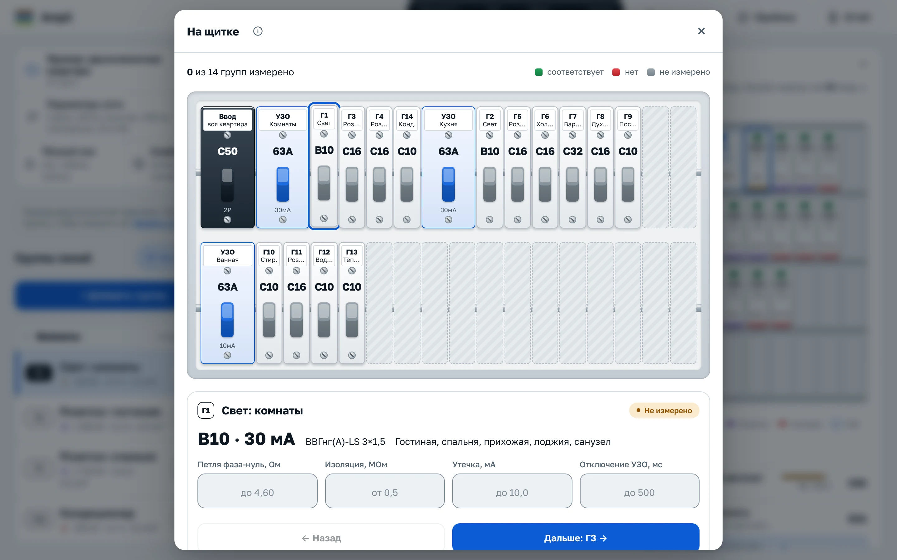
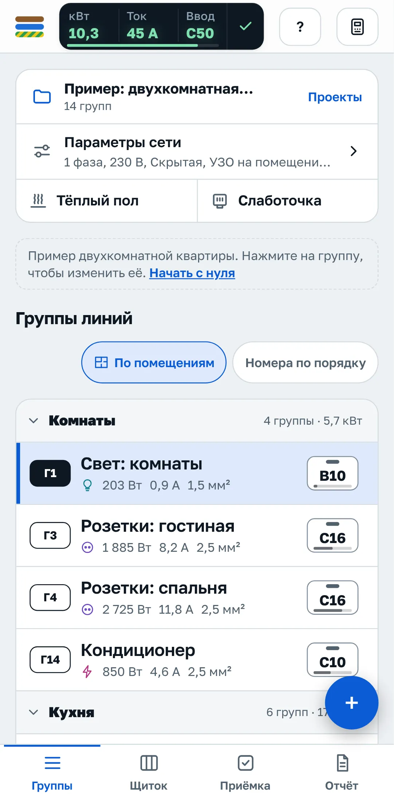
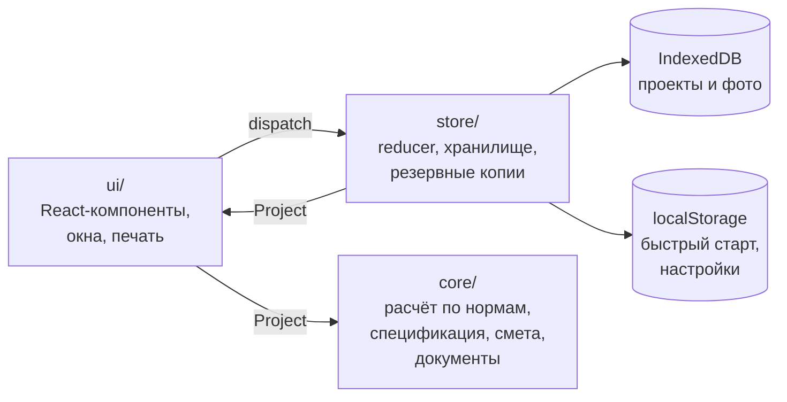

<div align="center">


# Ampli

**Расчёт электрощитка квартиры по нормам Республики Беларусь — от списка приборов до схемы А3, сметы и протокола замеров.**

[](https://github.com/AkselDjun/Ampli/actions/workflows/deploy.yml)
[](https://github.com/AkselDjun/Ampli/releases)
[](#тесты)
[](#нормы-и-допущения)

[](https://react.dev)
[](https://www.typescriptlang.org)
[](https://vite.dev)
[](https://vitest.dev)
[](https://playwright.dev)

[**Открыть приложение**](https://akseldjun.github.io/Ampli/) ·
[Возможности](#возможности) ·
[Быстрый старт](#быстрый-старт) ·
[Архитектура](#архитектура) ·
[Нормы](#нормы-и-допущения) ·
[Журнал изменений](CHANGELOG.md) ·
[Контекст проекта](PROJECT_CONTEXT.md)

<br>

<picture>
  <source media="(prefers-color-scheme: dark)" srcset="docs/screenshots/app-dark.webp">
  
</picture>

</div>

## О проекте

Ampli — веб-приложение для электриков, которые собирают щитки в квартирах. Вы вводите группы и приборы, а приложение сразу считает ток, подбирает автоматы и УЗО, сечение медных жил, проверяет потерю напряжения и отключение КЗ, раскладывает группы по фазам и рисует щиток. Из того же проекта получаются однолинейная схема на листе А3, спецификация, смета, акты, протокол замеров и паспорт для владельца.

Сервера нет: всё считается в браузере и хранится на устройстве, проект передаётся файлом или ссылкой.

> [!IMPORTANT]
> Результат расчёта предварительный. Проект щитка согласуйте с аттестованным электриком.

## Возможности

| | |
| --- | --- |
| ⚡ **Расчёт по нормам РБ** | Ток группы, автомат, сечение, потеря напряжения до самой дальней точки, петля фаза-нуль, селективность, одна или три фазы с выравниванием нагрузки |
| 🛡️ **Защита** | Дифавтомат на группу или УЗО на помещение, уставки 10 / 30 мА, тип A для стиральных машин, плит и зарядок, УЗДП, реле напряжения и УЗИП |
| 🧩 **Щиток** | Размер корпуса в модулях, схема с подписью каждого модуля, гребёнки, перемычки, наконечники, наклейки и бирки на кабели |
| 🔥 **Тёплый пол и слаботочка** | Подбор мата, кабеля или плёнки с проверкой шага и терморегулятора; UTP, ТВ, камеры с PoE и домофон с проверкой длины линии |
| 📏 **Монтаж и приёмка** | Режим «На щитке» для ввода замеров, чек-лист, фото групп, протокол замеров с реквизитами прибора |
| 📄 **Документы** | Схема А3 по ГОСТ 21.613-2014, акт скрытых работ по СН 1.03.04-2020, акт сдачи-приёмки, заключение по старой проводке, отчёт в PDF |
| 💰 **Смета и закупка** | Свои расценки, количества из проекта, экспорт в Excel и CSV, прайсы поставщиков и подстановка лучших цен |
| 🔗 **Передача** | Ссылка на проект, смету или паспорт без сервера, отправка в Viber и Telegram, файл JSON, сравнение вариантов |

<details>
<summary><b>Подробно: расчёт по нормам</b></summary>

<br>

- Группы освещения, розеток и силовые: ток по сумме всех приборов группы, автомат, сечение медных жил, потеря напряжения по СН 4.04.01-2019 (3 % освещение, 5 % прочие) до самой дальней точки, проверка отключения КЗ по петле фаза-нуль, селективность
- Защита на выбор: дифавтомат на каждую группу или УЗО на помещение с автоматами после него. Для УЗО подбирается номинал по сумме автоматов и уставка: 10 мА для особо опасных условий; если в помещении есть и обычные группы, они выносятся на отдельное УЗО 30 мА; розеточные группы всегда на 30 мА. Проверяется суммарная утечка, у каждого УЗО своя шина N в схеме и спецификации
- Тип УЗО: для групп со стиральной, сушильной и посудомоечной машиной, варочной панелью, электроплитой, кондиционером и зарядкой электромобиля подбирается УЗО или дифавтомат типа A
- Распределительные коробки: длина от щитка до коробки и отвод к каждому прибору. Потеря напряжения и КЗ считаются до самой дальней точки, в закупку идёт весь кабель с отводами. Тип коробки подбирается по прокладке или задаётся вручную
- Розеточные группы: число розеток и нагрузка на розетку идут в расчёт, смету и закупку; LED-лента по длине и мощности на метр
- Однофазное и трёхфазное питание, распределение групп по фазам и кнопка «Выровнять»
- Вводной автомат и кабель ввода с маркой (ВВГнг(А)-LS, ВВГнг(А)-FRLS, NYM), проверка выделенной мощности, запас автоматов
- Защита всего щитка по выбору: реле контроля напряжения (на трёх фазах по одному на фазу, свыше 63 А через контактор) и УЗИП тип 2
- УЗДП по выбору в «Параметрах сети»: на розеточные или на все однофазные группы, совмещённое с автоматом или дифавтоматом (1P+N, 2 модуля). Нормы Беларуси для квартир УЗДП не требуют, это решение заказчика
- Тёплый пол: мат под плитку, кабель в стяжку или плёнка под ламинат. Подбирается ближайший меньший мат, секция кабеля с длиной и шагом укладки, метраж плёнки; проверяются ток терморегулятора 16 А, шаг 7–15 см и требования к ванной (экран, присоединённый к PE, ТКП 339-2022 п. 8.7.21, ГОСТ 30331.11 п. 701.55). Питание отдельной группой с УЗО (СН 4.04.01-2019 п. 16.3.3, ТКП 339-2022 п. 8.7.4)
- Слаботочка: интернет (RJ45), телевидение, камеры с PoE и домофон по помещениям. Кабели UTP, коаксиальный и домофонный с запасом 10 %, розетки, коннекторы, коммутатор, делитель TV, слаботочный щиток; длина линии UTP до 90 м по ISO/IEC 11801
- Раздел «Почему так» с формулами и ссылками на пункты норм для каждой группы; допущения и источники в отчёте, практические значения помечены отдельно

</details>

<details>
<summary><b>Подробно: интерфейс и работа с проектом</b></summary>

<br>

- Итог по квартире всегда в шапке: расчётная мощность из выделенной с полосой загрузки, ток и вводной автомат; по нажатию подробности и переход к изменению выделенной мощности
- Табло «Нормы» в шапке: зелёная галочка или число замечаний, у каждого замечания переход к группе и быстрое исправление («Включить 3 фазы», «Параметры сети», «Вынести прибор в отдельную группу»)
- Новый пустой проект начинается с экрана «С чего начать»: собрать по комнатам, добавить группу нужного типа или открыть пример
- Меню быстрого добавления группы с подсказкой результата, большая кнопка «+» на телефоне
- Приборы группы в одну строку: название, мощность, штуки и отвод; Enter переходит к следующему полю и создаёт новую строку; справочник с поиском, недавними и своими шаблонами; быстрый ввод приборов текстом
- Список групп по помещениям со сворачиванием, свайпы на телефоне (влево удалить, вправо скопировать), кнопки при наведении на компьютере
- Выбранная группа подсвечивается на щитке, связь видна в обе стороны; автоматы похожи на настоящие, цвет полоски по типу группы, цвет рычажка по статусу
- Быстрые действия по <kbd>Ctrl</kbd>+<kbd>K</kbd> или <kbd>/</kbd>: поиск по группам и командам; <kbd>Ctrl</kbd>+<kbd>D</kbd> копирует группу, <kbd>Delete</kbd> удаляет, системная кнопка «Назад» закрывает окно
- Доступность: фокус не уходит из открытого окна, меню листаются стрелками, порядок групп меняется без перетаскивания, пересчёт озвучивается экранному диктору
- Светлая и тёмная тема, шкала из шести размеров шрифта, вибрация при подтверждении на телефоне
- Несколько проектов, сравнение вариантов, сохранение и загрузка файлом JSON

</details>

<details>
<summary><b>Подробно: монтаж, документы и передача</b></summary>

<br>

- Режим «На щитке»: щиток нарисован с автоматами на DIN-рейках. Нажмите на автомат и введите замеры (петля фаза-нуль, изоляция, утечка, время отключения УЗО); цвет рычажка показывает результат, в полях подсказаны допустимые значения
- Чек-лист монтажа и приёмки, протокол замеров с реквизитами прибора, фото группы (до, после, шильдик, замер) с подписями
- Наклейки для щитка по рядам и бирки на кабели с длиной (A4)
- Однолинейная схема щитка на листе A3 по ГОСТ 21.613-2014: рамка, штамп по форме 3, таблица групп; больше 20 групп раскладывается на несколько листов
- Акт освидетельствования скрытых работ по форме СН 1.03.04-2020 и акт сдачи-приёмки работ
- Обследование старой проводки: алюминий, сеть без PE, этажный щит TN-C, изоляция и износ; вывод «можно оставить / с условиями / заменить» со ссылками на нормы и печать заключения
- Отчёт для печати в PDF с логотипом, реквизитами исполнителя и подписью
- Смета работ со своими расценками, экспорт сметы и таблицы групп в Excel и CSV
- Ссылки на проект, смету для клиента (с кнопкой «Согласовать») и паспорт для владельца, отправка в Viber и Telegram с готовым текстом
- Закупка: поиск каждой позиции по магазинам, загрузка прайсов поставщиков (CSV или Excel), автоматический подбор и подстановка самой низкой цены в смету
- Паспорт для владельца: где какая группа, какой автомат, предельная нагрузка, что не включать одновременно и что делать, если автомат выключился
- Комплект для сдачи: отметьте документы и напечатайте одним файлом

</details>

## Скриншоты

<table>
  <tr>
    <td width="68%">
      <picture>
        <source media="(prefers-color-scheme: dark)" srcset="docs/screenshots/panel-dark.webp">
        
      </picture>
      <p align="center"><sub>Режим «На щитке»: замеры по каждому автомату</sub></p>
    </td>
    <td width="32%">
      <picture>
        <source media="(prefers-color-scheme: dark)" srcset="docs/screenshots/phone-dark.webp">
        
      </picture>
      <p align="center"><sub>На телефоне</sub></p>
    </td>
  </tr>
</table>

## Быстрый старт

Нужен Node.js 22 или новее (версия для CI зафиксирована в [`.nvmrc`](.nvmrc)).

```bash
git clone https://github.com/AkselDjun/Ampli.git
cd Ampli
npm ci
npm run dev
```

Приложение откроется на `http://localhost:5173`. При первом запуске показывается пример двухкомнатной квартиры.

### Скрипты

| Команда | Что делает |
| --- | --- |
| `npm run dev` | Сервер разработки с горячей перезагрузкой |
| `npm run build` | Проверка типов и production-сборка в `dist/` |
| `npm run preview` | Локальный просмотр собранной версии |
| `npm run check` | Линтер, типы и модульные тесты: запускайте перед пушем |
| `npm test` | Модульные тесты Vitest |
| `npm run test:cov` | Модульные тесты с покрытием (порог 90 %) |
| `npm run test:watch` | Vitest в режиме наблюдения |
| `npm run test:e2e` | Сценарии Playwright на телефоне и компьютере, замеры производительности |
| `npm run lint` | ESLint и Stylelint |
| `npm run typecheck` | `tsc --noEmit` |
| `npm run size` | Размер сборки в gzip с проверкой бюджета |

## Архитектура

Расчёт отделён от интерфейса: всё, что связано с нормами, живёт в чистых функциях без React и браузерных API, поэтому покрывается тестами целиком.



| Слой | Каталог | Ответственность |
| --- | --- | --- |
| **Core** | [`src/core`](src/core) | Чистые функции: расчёт групп (`calc.ts`), нормы и таблицы (`norms.ts`), защита щитка, тёплый пол, слаботочка, спецификация, смета, акты, паспорт, ссылки на проект. Не зависит от React |
| **Store** | [`src/store`](src/store) | Редьюсер проекта, чтение и запись в IndexedDB, фото, прайсы, библиотека шаблонов, резервные копии |
| **UI** | [`src/ui`](src/ui) | Компоненты React 19 с React Compiler, редкие окна загружаются по требованию |
| **Стили** | [`src/styles`](src/styles) | Токены дизайн-системы и правила компонентов |

### Хранение данных

- **Проекты** лежат в IndexedDB (`ampli-projects`), по одной записи на проект: сохранение одного проекта не переписывает остальные.
- **Быстрый старт.** Текущий проект и порядок списка дублируются в `localStorage`, поэтому первый экран рисуется сразу, а остальные проекты догружаются из IndexedDB. Данные из старых версий переносятся автоматически.
- **Защита от потери.** Как только появляется первый свой проект, приложение просит браузер не удалять данные при нехватке места (`navigator.storage.persist`) и раз в неделю напоминает сохранить резервную копию всех проектов в файл.
- **Фото** групп хранятся в отдельной базе IndexedDB (`ampli-photos`).

### Дизайн-система

Цвета, шрифты, отступы, скругления, тени, слои и анимации заданы токенами в [`src/styles/tokens.css`](src/styles/tokens.css), светлая и тёмная темы переключаются только через токены. Голые цвета в стилях запрещены линтером и тестом. Правила и полный список токенов: [docs/design-system.md](docs/design-system.md).

### Структура репозитория

```text
.
├── .github/workflows   CI, деплой на GitHub Pages, релизы
├── docs                дизайн-система, скриншоты
├── e2e                 сценарии Playwright: работа, доступность, безопасность, производительность
├── public              иконки приложения
├── scripts             бюджет размера сборки, выпуск релиза
└── src
    ├── core            расчёт и документы
    ├── store           состояние и хранение
    ├── styles          токены и стили
    ├── test            модульные тесты
    └── ui              интерфейс
```

## Нормы и допущения

| Документ | Что из него используется |
| --- | --- |
| **ТКП 339-2022** с изменением № 1 (с 01.08.2025) | Защита, УЗО, сечения, требования к ванным и тёплому полу. Допустимые токи кабеля взяты из таблицы 1.3.4 ПУЭ, на которую ссылается ТКП |
| **СН 4.04.01-2019** с изменениями № 1 и № 2 | Потеря напряжения (3 % освещение, 5 % прочие), отдельные линии. Изменение № 2 (постановление Минстройархитектуры от 17.09.2026 № 75, действует с 07.12.2026): по п. 14.4 водонагреватели и приборы отопления питаются отдельной линией и подключаются неразъёмно, формулировка взята из окончательной редакции проекта изменения |
| **ГОСТ 30331.15-2001** | Выбор и монтаж проводок |
| **ГОСТ 21.613-2014** | Оформление однолинейной схемы на листе А3 |
| **СН 1.03.04-2020** | Форма акта освидетельствования скрытых работ |

Раздел 8 ТКП 339-2022 исключён, требования к жилым зданиям перенесены в СП 4.04.04-2023; сверка с ним пока не выполнена. Частичная сверка расчётных оснований и список открытых вопросов: [docs/norm-audit-2026-11.md](docs/norm-audit-2026-11.md).

**Приняты по практике, а не по нормам:** коэффициенты спроса и одновременности, мощности приборов по умолчанию, уставки УЗО по помещениям, правила сборки комнат, сопротивление петли по умолчанию 0,30 Ом, размеры расходников щитка, параметры тёплого пола по умолчанию. В отчёте такие значения помечены отдельно, а редакция норм и версия приложения печатаются в каждом документе.

## Качество

### Тесты

- **Модульные тесты** на Vitest с покрытием не ниже 90 % по строкам, веткам и функциям. Эталонные тесты сверяют расчёт с нормами РБ, а [fast-check](https://fast-check.dev) проверяет свойства расчёта на случайных проектах.
- **Сценарии в браузере** на Playwright в двух профилях: телефон (Pixel 7) и компьютер. Отдельно проверяются доступность через axe в обеих темах, политика безопасности контента и производительность на замедленном в 4 раза процессоре.

Большинство тестов идёт в общем окружении без пересоздания модулей, так набор проходит примерно вдвое быстрее. Тесты, которые подменяют модули через `vi.mock`, кладите в [`src/test/isolated`](src/test/isolated): там каждый файл запускается отдельно.

### CI

На каждый пул-реквест параллельно запускаются проверки из [`ci.yml`](.github/workflows/ci.yml):

| Задача | Что проверяет |
| --- | --- |
| Lint and types | ESLint, Stylelint, TypeScript |
| Unit tests | Vitest с порогом покрытия |
| Build and size budget | Сборка и бюджет в gzip: самый большой JS 100 kB, CSS 25 kB, первый экран 195 kB, всё вместе 340 kB |
| Lighthouse | Производительность ≥ 85, доступность ≥ 95, лучшие практики ≥ 90; LCP ≤ 3 с, TBT ≤ 400 мс, CLS ≤ 0,1 |
| Browser tests | Playwright, при падении прикладываются трейсы |

Dependabot раз в неделю предлагает обновления npm-пакетов, сгруппированные по React, сборке, тестам и линтеру, и раз в месяц обновления GitHub Actions.

## Публикация и релизы

**Деплой.** После каждого пуша в `main` сначала проходят все проверки CI, затем на GitHub Pages публикуется уже собранная в них версия. В настройках репозитория: Settings → Pages → Source: GitHub Actions.

**Релизы** выходят автоматически каждый понедельник в 09:00 по Минску. Workflow считает изменённые строки с прошлого тега без `package-lock.json` и `CHANGELOG.md`: до 2000 строк поднимается patch, больше 2000 — minor. Если с прошлого релиза не было коммитов, релиз пропускается. Вручную: Actions → Release → Run workflow, выбрать `auto`, `patch`, `minor` или `major`.

Workflow прогоняет проверки, поднимает версию в `package.json`, дописывает в [CHANGELOG.md](CHANGELOG.md) смерженные пул-реквесты, ставит тег `vX.Y.Z` и создаёт GitHub Release. Если на `main` включена защита ветки, разрешите `github-actions[bot]` пушить в неё. Пока продукт не достиг MVP, версии остаются в диапазоне 0.x.

Версия печатается в каждом отчёте вместе с редакцией норм и видна в «Мои данные → Оформление»; после обновления приложение показывает уведомление.

<details>
<summary><b>Установка как приложение (PWA)</b></summary>

<br>

Установка на устройство и работа без интернета подготовлены, но сейчас выключены флагом `PWA_ENABLED` в [`src/core/flags.ts`](src/core/flags.ts). Пока флаг выключен, сайт не предлагает установку, а ранее установленный service worker удаляется вместе с кэшем при следующем заходе.

Если включить флаг:

- приложение устанавливается с сайта: в Chrome, Edge и на Android кнопкой «Установить приложение» в окне «Проекты», на iPhone и iPad через «Поделиться» → «На экран „Домой“»;
- работает без интернета, недоступен только поиск по магазинам;
- сообщает о новой версии и обновляется по кнопке «Обновить».

</details>

## Безопасность

У приложения нет сервера, данные не покидают устройство, пока вы сами не отправите файл или ссылку. Сборка задаёт строгую политику безопасности контента, ссылки на проект ограничены по размеру и проходят проверку после распаковки. Об уязвимостях сообщайте через вкладку Security, подробности в [SECURITY.md](SECURITY.md).

<div align="center">
<br>
<sub>Сделано для электриков Беларуси ⚡</sub>
</div>
