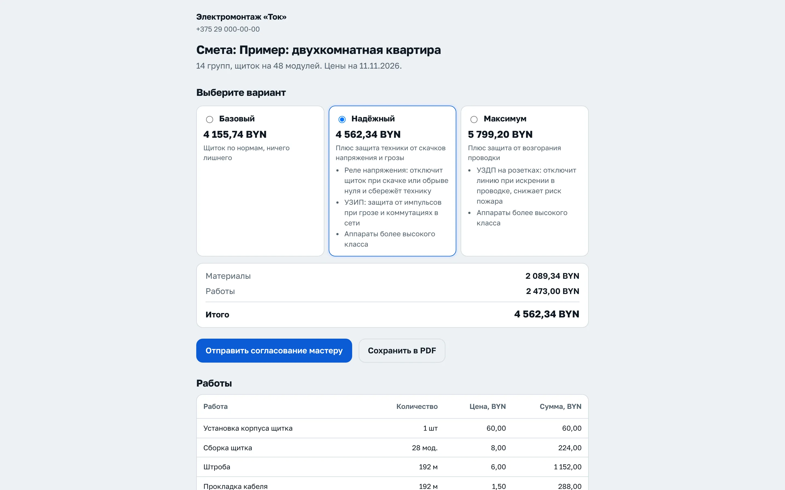
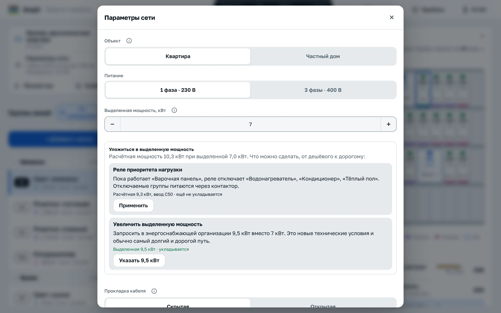
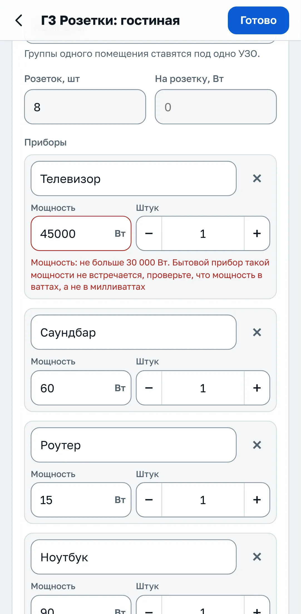
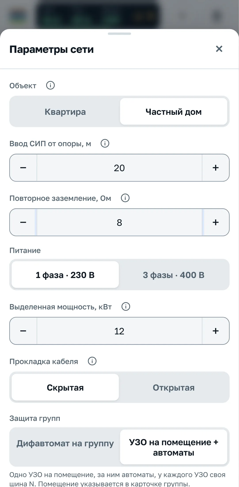
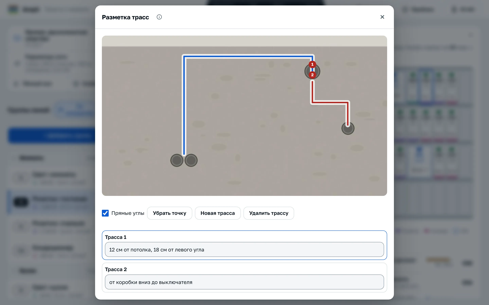
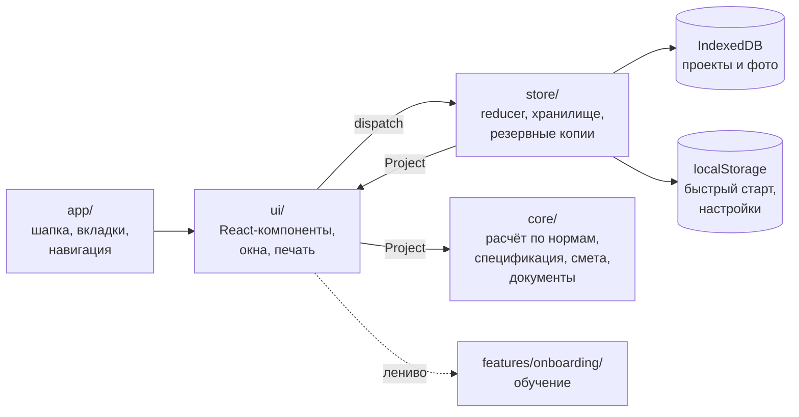

<div align="center">


# Ampli

**Расчёт электрощитка квартиры или частного дома по нормам Республики Беларусь: от списка приборов до схемы А3, сметы в трёх вариантах и протокола замеров.**

[](https://github.com/AkselDjun/Ampli/actions/workflows/deploy.yml)
[](https://github.com/AkselDjun/Ampli/releases)
[](#тесты)
[](#нормы-и-допущения)

[](https://react.dev)
[](https://www.typescriptlang.org)
[](https://vite.dev)
[](https://vitest.dev)
[](https://playwright.dev)

[**Открыть приложение**](https://akseldjun.github.io/Ampli/) ·
[Первые шаги](#первые-шаги) ·
[Возможности](#возможности) ·
[Скриншоты](#скриншоты) ·
[Разработка](#быстрый-старт) ·
[Нормы](#нормы-и-допущения) ·
[Журнал изменений](CHANGELOG.md)

<br>

<picture>
  <source media="(prefers-color-scheme: dark)" srcset="docs/screenshots/app-dark.webp">
  
</picture>

</div>

## О проекте

Ampli помогает электрикам, которые собирают щитки в квартирах и частных домах. Вы вводите группы и приборы, а приложение сразу считает ток, подбирает автоматы и УЗО, сечение медных жил, проверяет потерю напряжения и отключение КЗ, раскладывает группы по фазам и рисует щиток. Из того же проекта получаются однолинейная схема на листе А3, спецификация, смета для клиента, акты, протокол замеров, карта скрытой проводки и паспорт для владельца.

Сервера нет: всё считается в браузере и хранится на устройстве, проект передаётся файлом или ссылкой. Регистрация не нужна.

> [!IMPORTANT]
> Результат расчёта предварительный. Проект щитка согласуйте с аттестованным электриком.

## Первые шаги

Откройте [приложение](https://akseldjun.github.io/Ampli/) в браузере на телефоне или компьютере. При первом запуске Ampli покажет обучение из 9 коротких шагов в трёх главах: «Расчёт», «Монтаж» и «Документы». Его можно пройти сразу, отложить и продолжить с того же места; кнопка <kbd>?</kbd> в шапке открывает его снова. Пока вы осматриваетесь, на экране пример двухкомнатной квартиры: его можно менять, ничего не сломается.

Типичный путь от осмотра объекта до сдачи выглядит так.

| Шаг | Где в приложении | Что сделать |
| :---: | --- | --- |
| **1** | «Проекты» → «+ Новый проект» или ссылка «Начать с нуля» над списком групп | Начните с нуля: на экране «С чего начать» соберите группы по комнатам, добавьте группу нужного типа или откройте пример |
| **2** | «Параметры сети» | Выберите объект (квартира или частный дом), одну или три фазы, выделенную мощность, скрытую или открытую прокладку и схему защиты: дифавтомат на группу или УЗО на помещение |
| **3** | Список групп и карточка группы | Добавьте группы и впишите приборы: название, мощность, штуки, отвод от коробки. Поля сразу подсказывают, если значение похоже на опечатку |
| **4** | Шапка: итог и табло «Нормы» | Проверьте мощность, ток и вводной автомат. Каждое замечание ведёт к своей группе, многие исправляются одной кнопкой. Если мощность больше выделенной, в «Параметрах сети» появится блок «Уложиться в выделенную мощность» |
| **5** | Панель «Щиток» | Посмотрите корпус в модулях и раскладку аппаратов по рядам, при трёх фазах нажмите «Выровнять» |
| **6** | «Отчёт» → «Смета» | Впишите цены или загрузите прайс магазина, включите три варианта для клиента и отправьте ему ссылку |
| **7** | «Замеры» и «Приёмка» | На объекте отметьте пункты чек-листа, введите замеры по каждому автомату, сфотографируйте стены до штукатурки и разметьте трассы кабеля |
| **8** | «Приёмка» → «Комплект для сдачи» | Отметьте нужные документы и напечатайте их одним файлом, оставьте владельцу паспорт щитка |

<details>
<summary><b>Полезно знать с первого дня</b></summary>

<br>

- **Где хранятся данные.** Проекты лежат только на этом устройстве и в этом браузере. Раз в неделю Ampli напоминает сохранить резервную копию всех проектов в файл: окно «Проекты», вкладка «Обмен и данные». На другое устройство проект переносится файлом JSON или ссылкой.
- **Свои цены, шаблоны и реквизиты** задаются один раз в «Мои данные» (окно «Проекты», вкладка «Обмен и данные», или поиск <kbd>Ctrl</kbd>+<kbd>K</kbd>) и подставляются во все сметы и документы. Там же логотип, подпись исполнителя и тема оформления.
- **Почему так посчитано.** В карточке группы раздел «Как посчитано» показывает формулы и пункты норм. Значения, принятые по практике, в отчёте помечены отдельно.
- **Быстрые клавиши на компьютере.** <kbd>Ctrl</kbd>+<kbd>K</kbd> или <kbd>/</kbd> открывают поиск по группам и командам, <kbd>Ctrl</kbd>+<kbd>D</kbd> копирует группу, <kbd>Delete</kbd> удаляет, <kbd>Enter</kbd> в строке прибора переходит к следующему полю и создаёт новую строку.
- **На телефоне** внизу четыре вкладки: «Группы», «Щиток», «Приёмка», «Отчёт». Свайп по группе влево удаляет её, вправо копирует, большая кнопка «+» добавляет новую.
- **Частный дом** включается в «Параметрах сети» и добавляет ввод СИП от опоры, повторное заземление и УЗИП тип 1+2. Расчёт групп остаётся тем же.

</details>

## Возможности

| | |
| --- | --- |
| ⚡ **Расчёт по нормам РБ** | Ток группы по сумме приборов, автомат, сечение, потеря напряжения до самой дальней точки, петля фаза-нуль, селективность, одна или три фазы с выравниванием нагрузки |
| 🏠 **Квартира или частный дом** | Для дома: ввод СИП-4 от опоры, разделение PEN, повторное заземление, УЗИП тип 1+2, уличные группы под УЗО, котёл на отдельной линии |
| 🎚️ **Уложиться в выделенную мощность** | Реле приоритета нагрузки, переход на три фазы или новая выделенная мощность: каждый вариант уже посчитан и применяется одной кнопкой |
| 🛡️ **Защита** | Дифавтомат на группу или УЗО на помещение со своей шиной N, уставки 10 / 30 мА, тип A для стиральных машин, плит и зарядок, УЗДП, реле напряжения и УЗИП |
| 🧩 **Щиток** | Корпус в модулях, раскладка по рядам с подписью каждого модуля, гребёнки, перемычки, наконечники, наклейки и бирки на кабели |
| 🔥 **Тёплый пол и слаботочка** | Мат, кабель или плёнка с проверкой шага и терморегулятора; UTP, ТВ, камеры с PoE и домофон с проверкой длины линии |
| 📏 **Приёмка** | Чек-лист, замеры на щитке с протоколом в одном окне, фото групп, реквизиты прибора |
| 🧱 **Карта скрытой проводки** | Трассы кабеля на фото стены до штукатурки с привязкой к углу и потолку, отдельным документом и в комплекте для сдачи |
| 📄 **Документы** | Схема А3 по ГОСТ 21.613-2014, акт скрытых работ по СН 1.03.04-2020, акт сдачи-приёмки, заключение по старой проводке, паспорт для владельца, отчёт в PDF |
| 💰 **Смета в трёх вариантах** | «Базовый», «Надёжный» и «Максимум» со своей наценкой; клиент выбирает и согласует по ссылке, мастер применяет выбранный вариант к проекту |
| 🛒 **Закупка** | Поиск позиций по магазинам, прайсы поставщиков в CSV или Excel, подстановка лучших цен, экспорт сметы в Excel и CSV |
| ✅ **Проверка ввода** | Каждое поле знает реальные пределы: мощность прибора, длина линии, замеры, цены. Причина ошибки пишется прямо под полем |
| 🔗 **Передача** | Ссылка на проект, смету или паспорт без сервера, отправка в Viber и Telegram, файл JSON, сравнение вариантов |

<details>
<summary><b>Подробно: расчёт по нормам</b></summary>

<br>

- Группы освещения, розеток и силовые: ток по сумме всех приборов группы с учётом cos φ, автомат, сечение медных жил, потеря напряжения по СН 4.04.01-2019 (3 % освещение, 5 % прочие) до самой дальней точки, проверка отключения КЗ по петле фаза-нуль, селективность
- У прибора можно отметить «Не одновременно»: из таких приборов группы в расчёт идёт самый мощный. У кондиционеров, насосов и компрессоров cos φ по умолчанию 0,8
- Запас по автомату задаётся в «Параметрах сети». Стиральная, сушильная, посудомоечная машина и водонагреватель получают автомат не меньше 16 А, загрузка выше 90 % подсвечивается
- Защита на выбор: дифавтомат на каждую группу или УЗО на помещение с автоматами после него. Уставка 30 мА, в мокрых помещениях 10 мА; УЗО 10 мА не больше 40 А, иначе помещение делится на несколько УЗО. Проверяется суммарная утечка, у каждого УЗО своя шина N в схеме и спецификации
- Тип УЗО: для групп со стиральной, сушильной и посудомоечной машиной, варочной панелью, электроплитой, кондиционером и зарядкой электромобиля подбирается УЗО или дифавтомат типа A
- Распределительные коробки: длина от щитка до коробки и отвод к каждому прибору. Потеря напряжения и КЗ считаются до самой дальней точки, в закупку идёт весь кабель с отводами
- Розеточные группы: число розеток и нагрузка на розетку идут в расчёт, смету и закупку; LED-лента по длине и мощности на метр
- Однофазное и трёхфазное питание, распределение групп по фазам и кнопка «Выровнять»
- Вводной автомат и кабель ввода с маркой (ВВГнг(А)-LS, ВВГнг(А)-FRLS, NYM), марка кабеля групп, проверка выделенной мощности. Если вводной автомат вырос из-за селективности, проверка называет группу-причину и предлагает разделить её или перейти на три фазы
- **Уложиться в выделенную мощность.** Если расчётная мощность больше выделенной или однофазная нагрузка больше 12 кВт, в «Параметрах сети» появляются варианты от дешёвого к дорогому: реле приоритета нагрузки (водонагреватель, тёплый пол и другие отключаемые группы выключаются, пока работает плита), переход на три фазы и увеличение выделенной мощности. Каждый вариант показывает новую мощность и ввод, применяется одной кнопкой и добавляет реле и контакторы в щиток и спецификацию
- **Частный дом.** Ввод СИП-4 от опоры с проверкой потери напряжения (не больше 2 %, сечение от 16 мм²), разделение PEN, повторное заземление (больше 30 Ом ошибка), УЗИП тип 1+2, уличные группы под УЗО, котёл на отдельной группе, предупреждение, если петля фаза-нуль задана как в городе. Основной расчёт групп не меняется
- Защита всего щитка по выбору: реле контроля напряжения (на трёх фазах по одному на фазу, свыше 63 А через контактор) и УЗИП тип 2
- УЗДП по выбору: на розеточные или на все однофазные группы. Нормы Беларуси для квартир УЗДП не требуют, это решение заказчика
- Тёплый пол: мат под плитку, кабель в стяжку или плёнка под ламинат с проверкой тока терморегулятора 16 А, шага 7–15 см и требований к ванной (ТКП 339-2022 п. 8.7.21, ГОСТ 30331.11 п. 701.55). Питание отдельной группой с УЗО (СН 4.04.01-2019 п. 16.3.3, ТКП 339-2022 п. 8.7.4)
- Слаботочка: интернет (RJ45), телевидение, камеры с PoE и домофон по помещениям, кабели с запасом 10 %, длина линии UTP до 90 м по ISO/IEC 11801
- Зарядка электромобиля: отдельная группа на станцию, 11 и 22 кВт только на трёх фазах, УЗО типа A с контролем постоянного тока 6 мА или тип B. Если проект не укладывается в выделенную мощность, первым предлагается ограничить ток зарядки, и сразу посчитано, до скольких ампер
- Раздел «Как посчитано» с формулами и ссылками на пункты норм для каждой группы; допущения и источники в отчёте

</details>

<details>
<summary><b>Подробно: интерфейс и работа с проектом</b></summary>

<br>

- Итог по объекту всегда в шапке: расчётная мощность из выделенной с полосой загрузки, ток и вводной автомат; по нажатию подробности
- Табло «Нормы» в шапке: зелёная галочка или число замечаний, у каждого переход к группе и быстрое исправление («Включить 3 фазы», «Параметры сети», «Вынести прибор в отдельную группу»)
- Карточка группы устроена по частоте использования: сверху результат и замечания, затем тип, длина, фаза, помещение и приборы; внизу свёрнутые «Дополнительно», «Замеры и фото» и «Как посчитано»
- Одно поле «Помещение»: оно группирует УЗО и печатается на щитке, бирках и в паспорте
- Проверка ввода: у каждого числового поля есть реальный диапазон, ошибка с причиной показывается под полем, а значения из файлов и ссылок приводятся к тем же пределам
- Приборы в одну строку, справочник с поиском, недавними и своими шаблонами, быстрый ввод приборов текстом
- Диктовка списка приборов и комнат голосом (числа словами становятся цифрами) и вставка сообщения клиента вида «Кухня: плита 7 кВт, чайник» сразу в комнаты
- Список групп по помещениям или по номерам, сворачивание помещений, полоса загрузки автомата на строке
- Выбранная группа подсвечивается на щитке, связь видна в обе стороны; цвет полоски по типу группы, цвет рычажка по статусу
- Подсказки глав обучения при первом открытии замеров, приёмки и отчёта
- Доступность: фокус не уходит из открытого окна, меню листаются стрелками, порядок групп меняется без перетаскивания, пересчёт озвучивается экранному диктору
- Светлая и тёмная тема, шкала из шести размеров шрифта, вибрация при подтверждении на телефоне
- Несколько проектов, сравнение вариантов, статус сохранения в шапке

</details>

<details>
<summary><b>Подробно: монтаж, документы и передача</b></summary>

<br>

- Замеры на щитке (вкладка «Замеры» в окне «Приёмка», кнопка «Замеры» в шапке): щиток нарисован с автоматами на DIN-рейках, рядом реквизиты протокола и список результатов по группам. Нажмите на автомат и введите замеры (петля фаза-нуль, изоляция, утечка, время отключения УЗО); цвет рычажка показывает результат, под полями подсказаны допустимые значения, по кнопке «Дальше» переход к следующей группе
- Чек-лист монтажа и приёмки, протокол замеров с реквизитами прибора, фото группы (до, после, стена, шильдик, замер) с подписями
- Карта скрытой проводки: на фото с тегом «Стена» отмечаются трассы кабеля (до 12 трасс, с прямыми углами отрезки идут строго по горизонтали и вертикали) и привязка текстом. Карта печатается отдельным документом и в комплекте для сдачи, акт скрытых работ ссылается на неё. Фото не передаются ссылкой, поэтому владельцу карта уходит печатью или в PDF
- Наклейки для щитка по рядам и бирки на кабели с длиной (A4)
- Однолинейная схема щитка на листе A3 по ГОСТ 21.613-2014: рамка, штамп по форме 3, таблица групп; больше 20 групп раскладывается на несколько листов
- Акт освидетельствования скрытых работ по форме СН 1.03.04-2020 и акт сдачи-приёмки работ
- Обследование старой проводки: алюминий, сеть без PE, этажный щит TN-C, изоляция и износ; вывод «можно оставить / с условиями / заменить» со ссылками на нормы
- Смета в трёх вариантах: «Базовый» (проект как есть), «Надёжный» (плюс реле напряжения и УЗИП) и «Максимум» (плюс УЗДП на розетки). Варианты только добавляют защиту и никогда её не убирают, наценка на материалы своя у каждого. Вариант, который ничего не добавляет, не показывается. Клиент выбирает вариант по ссылке и согласует его, мастер одной кнопкой применяет выбранный вариант к проекту
- Смета работ со своими расценками, экспорт сметы и таблицы групп в Excel и CSV
- Закупка: поиск каждой позиции по магазинам, загрузка прайсов поставщиков, автоматический подбор и подстановка самой низкой цены
- Паспорт для владельца: где какая группа, какой автомат, предельная нагрузка, что не включать одновременно и что делать, если автомат выключился
- Ссылки на проект, смету для клиента и паспорт для владельца, отправка в Viber и Telegram с готовым текстом
- Комплект для сдачи: отметьте документы и напечатайте одним файлом

</details>

## Скриншоты

Все снимки сделаны на текущей версии и показываются в теме, выбранной на GitHub.

<table>
  <tr>
    <td width="66%">
      <picture>
        <source media="(prefers-color-scheme: dark)" srcset="docs/screenshots/estimate-dark.webp">
        
      </picture>
      <p align="center"><sub>Смета для клиента: три варианта на выбор</sub></p>
    </td>
    <td width="34%">
      <picture>
        <source media="(prefers-color-scheme: dark)" srcset="docs/screenshots/phone-dark.webp">
        
      </picture>
      <p align="center"><sub>Группы по помещениям на телефоне</sub></p>
    </td>
  </tr>
  <tr>
    <td width="66%">
      <picture>
        <source media="(prefers-color-scheme: dark)" srcset="docs/screenshots/powerfit-dark.webp">
        
      </picture>
      <p align="center"><sub>Уложиться в выделенную мощность</sub></p>
    </td>
    <td width="34%">
      <picture>
        <source media="(prefers-color-scheme: dark)" srcset="docs/screenshots/editor-dark.webp">
        
      </picture>
      <p align="center"><sub>Проверка ввода в карточке группы</sub></p>
    </td>
  </tr>
  <tr>
    <td width="66%">
      <picture>
        <source media="(prefers-color-scheme: dark)" srcset="docs/screenshots/panel-dark.webp">
        
      </picture>
      <p align="center"><sub>Замеры на щитке: значения по каждому автомату</sub></p>
    </td>
    <td width="34%">
      <picture>
        <source media="(prefers-color-scheme: dark)" srcset="docs/screenshots/house-dark.webp">
        
      </picture>
      <p align="center"><sub>Режим «Частный дом»</sub></p>
    </td>
  </tr>
  <tr>
    <td colspan="2">
      <picture>
        <source media="(prefers-color-scheme: dark)" srcset="docs/screenshots/wiring-dark.webp">
        
      </picture>
      <p align="center"><sub>Карта скрытой проводки: трассы на фото стены с привязкой</sub></p>
    </td>
  </tr>
</table>

## Быстрый старт

Нужен Node.js 22 или новее (версия для CI зафиксирована в [`.nvmrc`](.nvmrc)).

```bash
git clone https://github.com/AkselDjun/Ampli.git
cd Ampli
npm ci
npm run dev
```

Приложение откроется на `http://localhost:5173`. При первом запуске показываются обучение и пример двухкомнатной квартиры.

### Скрипты

| Команда | Что делает |
| --- | --- |
| `npm run dev` | Сервер разработки с горячей перезагрузкой |
| `npm run build` | Проверка типов и production-сборка в `dist/` |
| `npm run preview` | Локальный просмотр собранной версии |
| `npm run check` | Линтеры, типы и модульные тесты: запускайте перед пушем |
| `npm test` | Модульные тесты Vitest |
| `npm run test:cov` | Модульные тесты с покрытием (порог 90 %) |
| `npm run test:watch` | Vitest в режиме наблюдения |
| `npm run test:e2e` | Сценарии Playwright на телефоне и компьютере, замеры производительности |
| `npm run lint` | ESLint и Stylelint |
| `npm run typecheck` | `tsc --noEmit` |
| `npm run size` | Размер сборки в gzip с проверкой бюджета (после `npm run build`) |

## Архитектура

Расчёт отделён от интерфейса: всё, что связано с нормами, живёт в чистых функциях без React и браузерных API, поэтому покрывается тестами целиком.



| Слой | Каталог | Ответственность |
| --- | --- | --- |
| **Core** | [`src/core`](src/core) | Чистые функции: расчёт групп (`calc.ts`), нормы (`norms.ts`), защита (`protection.ts`), частный дом (`house.ts`), укладка в мощность (`powerfit.ts`), варианты сметы (`tiers.ts`), трассы (`traces.ts`), тёплый пол, слаботочка, спецификация, смета, акты, паспорт, ссылки. Не зависит от React |
| **Store** | [`src/store`](src/store) | Редьюсер проекта, IndexedDB, фото, прайсы, библиотека цен и шаблонов, резервные копии |
| **App** | [`src/app`](src/app) | Шапка, вкладки, навигация, стек окон |
| **UI** | [`src/ui`](src/ui) | Компоненты React 19 с React Compiler; редкие окна, разметка трасс и смета для клиента загружаются по требованию |
| **Features** | [`src/features/onboarding`](src/features/onboarding) | Модель, раскладка и хранение обучения; экран обучения в отдельном чанке |
| **Стили** | [`src/styles`](src/styles) | Токены, именованные брейкпоинты и файлы по экранам в слоях `@layer` |

Границы слоёв проверяет [`src/test/architecture/boundaries.test.ts`](src/test/architecture/boundaries.test.ts): `core` не импортирует `app`, `store` и `ui`; `store` не импортирует `app` и `ui`; модель обучения не зависит от React.

### Хранение и защита данных

- **Проекты** лежат в IndexedDB (`ampli-projects`), по одной записи на проект: сохранение одного проекта не переписывает остальные. Фото в отдельной базе `ampli-photos`.
- **Быстрый старт.** Текущий проект дублируется в `localStorage`, поэтому первый экран рисуется сразу, а остальные проекты догружаются из IndexedDB.
- **Защита от потери.** Приложение просит браузер не удалять данные (`navigator.storage.persist`), раз в неделю напоминает сохранить резервную копию и не даёт двум вкладкам перезаписать друг друга.
- **Проверка импорта.** Проекты из файлов, ссылок, резервных копий и хранилища приводятся к тем же пределам, что и ввод в редакторе: лишние поля отбрасываются, число групп, приборов, помещений и проектов ограничено. Архив проверяется до восстановления, импорт не больше 32 МБ, у фото, логотипа, прайсов и xlsx свои лимиты размера, из резервной копии принимаются только JPEG, PNG и WebP.

### Стили и дизайн-система

Цвета, шрифты, отступы, скругления, тени, слои и анимации заданы токенами в [`src/styles/tokens.css`](src/styles/tokens.css), светлая и тёмная темы переключаются только через токены. Голые цвета запрещены линтером и тестом.

- [`app.css`](src/styles/app.css) собирает файлы через `@import` и задаёт порядок слоёв `@layer tokens, base, components`, поэтому базовые стили никогда не перебивают компоненты.
- Стили разбиты по экранам: `kit.css`, `layout.css`, `appbar.css`, `group-list.css`, `editor.css`, `panel.css`, `sheets.css`, отдельные файлы для обучения, вариантов сметы и трасс.
- Ширины экранов задаются только именованными брейкпоинтами `@custom-media` из `media.css` (`--phone`, `--tablet`, `--desktop`, `--wide`), Lightning CSS подставляет запросы при сборке.
- Стили печати в `print.css` подключаются отдельным `<link media="print">` и не входят в основной CSS.
- Все поля берут размеры только из токенов `--field-*`, это проверяют модульный и браузерный тесты.

Правила и полный список токенов: [docs/design-system.md](docs/design-system.md).

### Структура репозитория

```text
.
├── .github/workflows   CI, деплой на GitHub Pages, релизы
├── docs                дизайн-система, сверка норм, скриншоты
├── e2e                 Playwright: сценарии, поля, доступность, безопасность, данные, обучение, производительность
├── public              иконки приложения
├── scripts             бюджет размера сборки, выпуск релиза
└── src
    ├── app             шапка, вкладки, навигация
    ├── core            расчёт и документы
    ├── features        обучение
    ├── store           состояние и хранение
    ├── styles          токены, брейкпоинты, стили по экранам
    ├── test            модульные тесты
    └── ui              интерфейс
```

Для участников: коротко о решениях и правилах работы в [PROJECT_CONTEXT.md](PROJECT_CONTEXT.md).

## Нормы и допущения

| Документ | Что из него используется |
| --- | --- |
| **ТКП 339-2022** с изменением № 1 (с 01.08.2025) | Защита, УЗО, сечения, требования к ванным и тёплому полу. Допустимые токи кабеля взяты из таблицы 1.3.4 ПУЭ, на которую ссылается ТКП |
| **СН 4.04.01-2019** с изменениями № 1 и № 2 | Потеря напряжения (3 % освещение, 5 % прочие), отдельные линии. Изменение № 2 (постановление Минстройархитектуры от 17.09.2026 № 75, действует с 07.12.2026): по п. 14.4 водонагреватели и приборы отопления питаются отдельной линией и подключаются неразъёмно |
| **ГОСТ 30331.15-2001** | Выбор и монтаж проводок |
| **ГОСТ 21.613-2014** | Оформление однолинейной схемы на листе А3 |
| **СН 1.03.04-2020** | Форма акта освидетельствования скрытых работ |

Раздел 8 ТКП 339-2022 исключён, требования к жилым зданиям перенесены в СП 4.04.04-2023; сверка с ним пока не выполнена. Частичная сверка расчётных оснований и список открытых вопросов: [docs/norm-audit-2026-11.md](docs/norm-audit-2026-11.md).

**Приняты по практике, а не по нормам:** коэффициенты спроса и одновременности, мощности приборов по умолчанию, оценка утечки 0,4 мА/А, реле приоритета нагрузки, правила сборки комнат, сопротивление петли по умолчанию 0,30 Ом, размеры расходников щитка, параметры тёплого пола по умолчанию. Они перечислены в `src/core/assumptions.ts` и в отчёте помечены отдельно, а редакция норм и версия приложения печатаются в каждом документе.

## Качество

### Тесты

- **Модульные тесты** на Vitest с покрытием не ниже 90 % по строкам, веткам и функциям. Эталонные тесты сверяют расчёт с нормами РБ, а [fast-check](https://fast-check.dev) проверяет свойства расчёта на случайных проектах. Отдельные тесты следят за токенами, единым форматом полей и границами слоёв.
- **Сценарии в браузере** на Playwright в двух профилях: телефон (Pixel 7) и компьютер. Отдельно проверяются доступность через axe в обеих темах, политика безопасности контента, сохранность данных, обучение и производительность на проекте из 140 групп при замедленном в 4 раза процессоре.

Большинство тестов идёт в общем окружении без пересоздания модулей, так набор проходит примерно вдвое быстрее. Тесты, которые подменяют модули через `vi.mock`, кладите в [`src/test/isolated`](src/test/isolated): там каждый файл запускается отдельно.

### Бюджеты

| Что | Порог | Сейчас |
| --- | --- | --- |
| Первый экран (gzip): входной скрипт, `modulepreload` и стили из `dist/index.html` | 195 kB | 193,3 kB |
| Вся сборка (gzip) | 340 kB | 305,2 kB |
| Самый большой JS-файл | 100 kB | |
| Самый большой CSS-файл | 25 kB | |
| Lighthouse | производительность ≥ 85, доступность ≥ 95, лучшие практики ≥ 90 | |
| Web Vitals | LCP ≤ 3 с, TBT ≤ 400 мс, CLS ≤ 0,1 | |

Запас первого экрана почти исчерпан, поэтому новые крупные функции выносятся в ленивые чанки: они не замедляют старт и проверяются только общим бюджетом. Таблицу по файлам печатает `npm run size`.

### CI

На каждый пул-реквест параллельно запускаются проверки из [`ci.yml`](.github/workflows/ci.yml):

| Задача | Что проверяет |
| --- | --- |
| Lint and types | ESLint, Stylelint, TypeScript |
| Unit tests | Vitest с порогом покрытия |
| Build and size budget | Сборка и бюджеты размера |
| Lighthouse | Производительность, доступность, лучшие практики, Web Vitals |
| Browser tests | Playwright, при падении прикладываются трейсы |

Dependabot раз в неделю предлагает обновления npm-пакетов, сгруппированные по React, сборке, тестам и линтеру, и раз в месяц обновления GitHub Actions.

## Публикация и релизы

**Деплой.** После каждого пуша в `main` сначала проходят все проверки CI, затем на GitHub Pages публикуется уже собранная в них версия. В настройках репозитория: Settings → Pages → Source: GitHub Actions.

**Релизы** выходят автоматически каждый понедельник в 09:00 по Минску. Workflow считает изменённые строки с прошлого тега без `package-lock.json` и `CHANGELOG.md`: до 2000 строк поднимается patch, больше 2000 — minor. Если с прошлого релиза не было коммитов, релиз пропускается. Вручную: Actions → Release → Run workflow, выбрать `auto`, `patch`, `minor` или `major`.

Workflow прогоняет проверки, поднимает версию в `package.json`, дописывает в [CHANGELOG.md](CHANGELOG.md) смерженные пул-реквесты, ставит тег `vX.Y.Z` и создаёт GitHub Release. Пока продукт не достиг MVP, версии остаются в диапазоне 0.x.

Версия печатается в каждом отчёте вместе с редакцией норм и видна в «Мои данные → Оформление»; после обновления приложение показывает уведомление.

<details>
<summary><b>Установка как приложение (PWA)</b></summary>

<br>

Установка на устройство и работа без интернета подготовлены, но сейчас выключены флагом `PWA_ENABLED` в [`src/core/flags.ts`](src/core/flags.ts). Пока флаг выключен, сайт не предлагает установку, а ранее установленный service worker удаляется вместе с кэшем при следующем заходе.

Если включить флаг:

- приложение устанавливается с сайта: в Chrome, Edge и на Android кнопкой «Установить приложение» в окне «Проекты», на iPhone и iPad через «Поделиться» → «На экран „Домой“»;
- работает без интернета, недоступен только поиск по магазинам;
- сообщает о новой версии и обновляется по кнопке «Обновить».

</details>

## Безопасность

У приложения нет сервера, данные не покидают устройство, пока вы сами не отправите файл или ссылку. Сборка задаёт строгую политику безопасности контента, ссылки на проект ограничены по размеру и проходят проверку после распаковки, импортированные проекты и файлы приводятся к допустимым пределам. Об уязвимостях сообщайте через вкладку Security, подробности в [SECURITY.md](SECURITY.md).

<div align="center">
<br>
<sub>Сделано для электриков Беларуси ⚡</sub>
</div>
